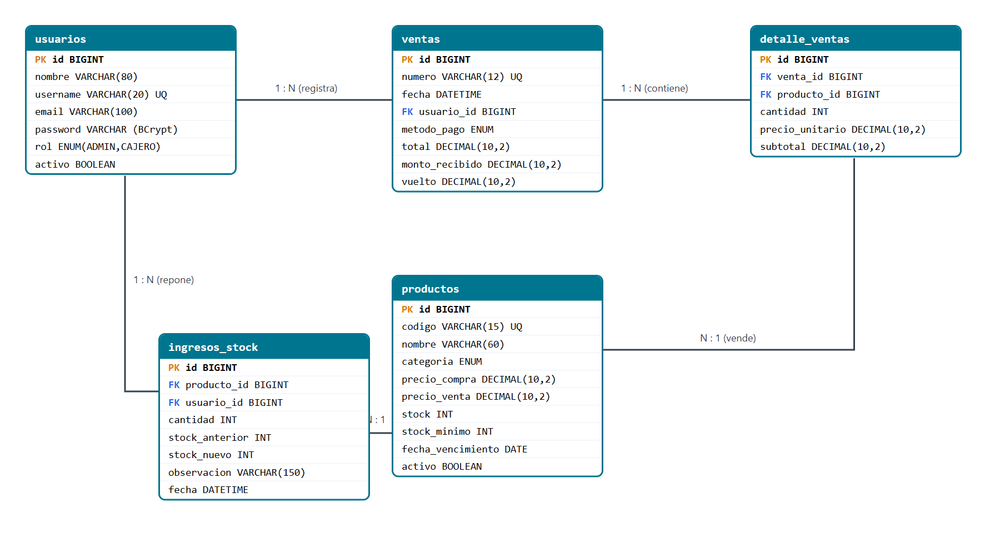

# BD – Base de datos de BodegaControl

Scripts de la base de datos `bodegacontrol` en MySQL 8.4, exportados desde la base que usa el backend.

| Archivo | Contenido |
|---------|-----------|
| `01_estructura.sql` | Crea la base `bodegacontrol` y sus 5 tablas con claves primarias, únicas y foráneas |
| `02_datos.sql` | Datos de ejemplo: usuarios, 18 productos, ventas con su detalle e ingresos de stock |
| `bodegacontrol_completo.sql` | Respaldo completo (estructura + datos) en un solo archivo |
| `modelo_er.png` | Diagrama entidad-relación |



## Importar

```bash
mysql -u root -p < 01_estructura.sql
mysql -u root -p < 02_datos.sql
```

O en un solo paso:

```bash
mysql -u root -p < bodegacontrol_completo.sql
```

También se puede abrir cada archivo en MySQL Workbench y ejecutarlo.

> No es obligatorio importar los scripts: al iniciar el backend, JPA crea las tablas y carga los datos de
> ejemplo si la base está vacía.

## Tablas

| Tabla | Descripción |
|-------|-------------|
| `usuarios` | Usuarios del sistema con rol ADMIN o CAJERO (contraseña cifrada con BCrypt) |
| `productos` | Catálogo con precios, stock, stock mínimo y fecha de vencimiento |
| `ventas` | Cabecera de la venta: número, fecha, cajero, método de pago, total y vuelto |
| `detalle_ventas` | Productos de cada venta con cantidad, precio unitario y subtotal |
| `ingresos_stock` | Reposiciones de mercadería con el stock anterior y el nuevo |

Usuarios de ejemplo: `admin` / `admin123` (ADMIN) y `cajero` / `cajero123` (CAJERO).
